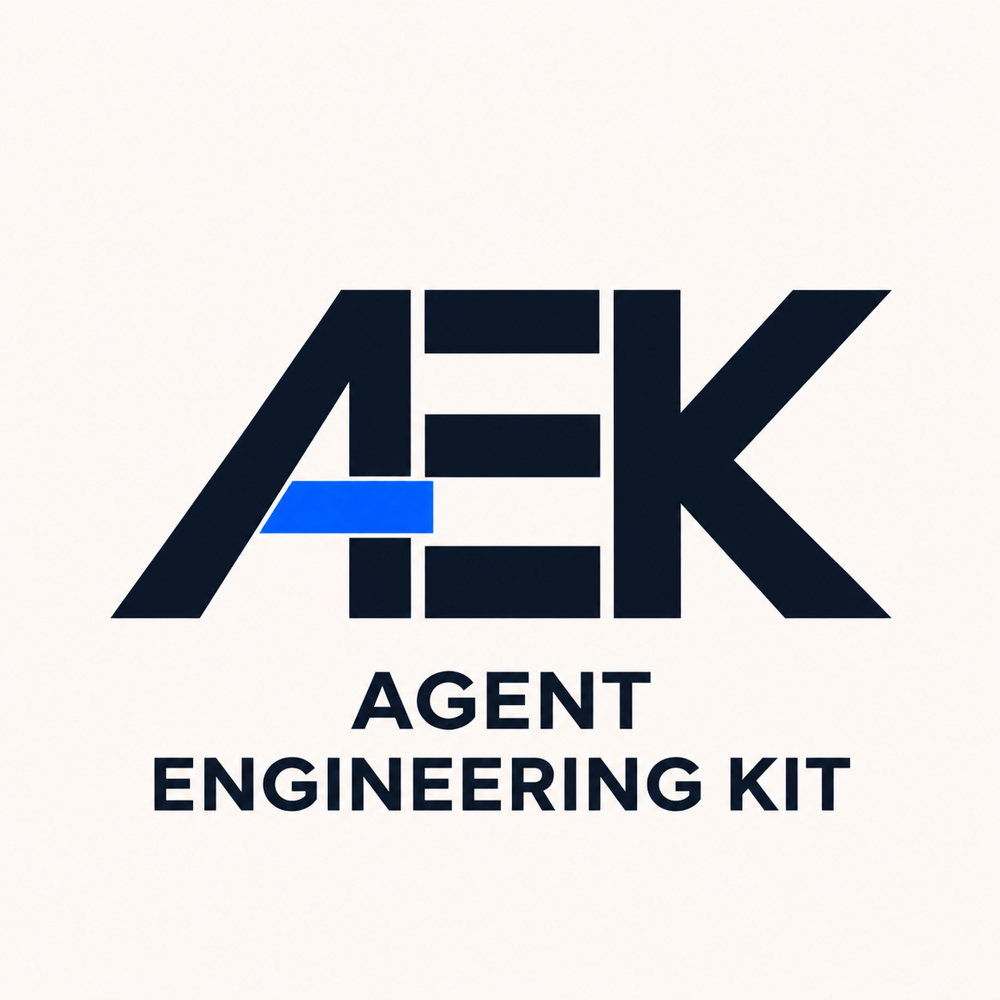

# Agent Engineering Kit

<p align="center">
  <picture>
    <source media="(prefers-color-scheme: dark)" srcset="docs/assets/agent-engineering-kit-logo-dark-v2.png">
    <source media="(prefers-color-scheme: light)" srcset="docs/assets/agent-engineering-kit-logo-v2.png">
    
  </picture>
</p>

Reusable engineering instructions for AI coding agents in Codex, Claude Code and
Cursor. The goal is consistent architecture, implementation, testing and review,
adapted to your project's technologies and local requirements.

## Choose how to use AEK

| Your goal | Start here | What you get |
| --- | --- | --- |
| Try AEK on a design, code review or profile-selection task | [Free Agensi skill](https://www.agensi.io/skills/agent-engineering-kit), through an agent connected to Agensi | Guidance from a dated reference snapshot for the current task |
| Keep AEK instructions in your project | [Integration](#integration), using this source library | Reviewed, project-specific instructions and an adoption record for later updates |

The Agensi edition loads references on demand through MCP. It does not install
project rules or keep an existing adoption synchronized with this repository.
For persistent adoption, obtain this source library separately and use the
integration wizard below. Superpowers is a separate plugin and is not bundled.

Example first request through Agensi:

```text
Use Agent Engineering Kit to review the code I provide.
Identify concrete defects and architecture risks, prioritize the findings,
and explain the evidence for each. Report missing context and checks you did
not run. Do not edit files or run commands.
```

## Integration

Clone or download this library and open your project in an AI coding client.
For a new project, open its intended parent workspace. The chat wizard analyzes
an existing stack or asks about intended technologies, selects relevant instructions
and guides you through reviewing and applying the changes.

**Copy one of these example requests into your AI chat.** Replace `<framework-path>`
with the library location and `<project-path>` with your target project path,
both accessible to the agent. [SETUP.md](SETUP.md) is the entry point; when this
library is your current workspace, you can use `SETUP.md` directly.

**Example 1: AI request for an existing project**

```text
Read <framework-path>/SETUP.md and open
the Agent Engineering Kit integration wizard for my existing project at <project-path>.
Inspect its technologies and current instructions, then propose the relevant rules.
Show the changes for my approval before applying them.
```

**Example 2: AI request for a new project**

```text
Read <framework-path>/SETUP.md and open
the Agent Engineering Kit integration wizard for a new project at <project-path>.
Ask me about its goals, languages and frameworks, then prepare the relevant instructions.
Show the proposed files and their contents for my approval before creating them.
```

After integration, give your agent normal development tasks in that project.
See the [integration guide](MIGRATION.md) for updates, checks and recovery.

## Supported instructions

| Area | Coverage |
| --- | --- |
| Engineering workflow | Architecture, code style, planning, testing, review, Git safety and agent collaboration |
| Python | FastAPI, Pydantic, SQLAlchemy, Psycopg |
| PHP | Symfony, Doctrine |
| Go | Gin, Eino, LangChainGo |
| JavaScript / TypeScript | Node.js, NestJS, React, Next.js, Angular, NgRx, TypeORM |
| Database and containers | PostgreSQL, Docker |
| RAG and LLM applications | [RAG](standards/rag.md), [tools and workflows](standards/llm-tools.md), LlamaIndex, Eino, LangChain/LangChainGo, LangGraph, Langfuse |
| Game development | Unreal Engine (C++, Blueprints); Godot (GDScript, conditional C#/GDExtension guidance) |

Choose only applicable profiles from the [instruction catalog](standards/catalog.md).
