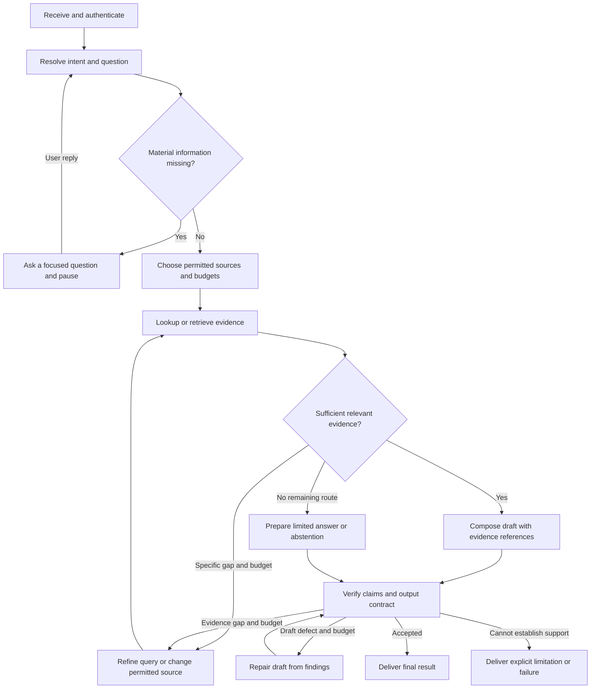

# Tool workflows

Read when composing application steps; return to the [tool entry](../llm-tools.md).
[Architecture](../llm/architecture.md) owns responsibility placement;
[tool contracts](contracts.md), [source access](source-access.md) and
[execution](execution.md) own invocation rules. Apply [answer checks](../llm/answers.md)
when the selected flow produces an answer. These are application design rules,
not a required tool sequence for the coding assistant.

## Example question-to-answer workflow

The diagram and stage table illustrate one possible design for a source-grounded
assistant. They do not prescribe a minimum number of steps, LLM/tool calls, agents
or a mandatory graph. Select, combine, omit, reorder or extend stages to meet the
actual goal while preserving data dependencies and the application's required
authorization, evidence and delivery guarantees. Make the chosen transitions and
contracts explicit; independent authorized retrieval branches may run concurrently.

| Goal | Illustrative flow | Complexity to add only when needed |
| --- | --- | --- |
| Return a known record value | Validate request and access → lookup → format and return | Clarification only for an ambiguous identifier; generation may be unnecessary |
| Answer a documentation question | Retrieve → compose a supported answer → return with applicable checks | Separate intent routing, reranking or a model-based verifier only for a demonstrated need |
| Research a question across sources | Resolve scope → plan/decompose → retrieve across sources → reconcile evidence → compose → verify → deliver | Bounded iterative research, parallel branches, specialist agents or human review according to the goal |

These are examples rather than an exhaustive list or required complexity levels.
Choose the smallest design that meets the actual requirements, including a more
complex workflow from the outset when those requirements justify it.

For a greeting or a task requiring no external facts, the policy may bypass
retrieval and go to an appropriate answer with ordinary output checks. A requested
business action branches into its separate authorized action path; it is not
implicitly executed by this information-answering diagram. Cancellation can stop
any stage and must not trigger later delivery/actions.

| Stage | Decision or output | Important alternative |
| --- | --- | --- |
| Receive | Authenticated request, conversation ownership, original question and deadline | Reject invalid/unauthorized scope without disclosing private records |
| Resolve intent | Supported task kind, entities, temporal scope and whether external evidence is needed | Use an `unknown` route when classification cannot establish a valid task |
| Clarify | One focused question about material missing information; resumable state | Skip when existing context is sufficient; do not ask merely to run every stage |
| Route | Permitted source plan, authority/freshness requirements and budgets | Current records to DB/API; documents to retrieval; public current facts to permitted web |
| Retrieve | Typed source results, provenance, source failures and truncation | A source outage, empty result and forbidden scope remain distinct internally |
| Assess evidence | Coverage of the facts needed for the answer | Identify a specific gap; refine within budget, ask a question or stop with limitations |
| Compose | Draft answer and claim-to-evidence mapping | State conflicting/partial evidence; do not manufacture a missing fact |
| Verify | Checked deterministic facts, source references and applicable semantic criteria | Repair unsupported claims or acquire missing evidence within remaining budget |
| Deliver | Answer or explicit terminal status, citations and material limitations | Distinguish successful response construction from transport delivery failure |

Keep the state required by the chosen flow explicit. For the illustrated workflow,
this can include request/conversation ID, original question, validated intent,
clarification state, source plan, evidence registry, source errors, draft,
verification findings, budget counters and final status. Omit state for absent
stages; a simple lookup need not maintain an agent conversation or checkpoint. Use
a separate trusted context for identity/capabilities; do not serialize live clients,
credentials or database connections into a checkpoint.

Allow only registered routes and tools. A classifier emits a validated enum and
slots, not an executable tool name, SQL statement or arbitrary graph destination.
Use confidence thresholds only when calibrated; a model's self-reported confidence
is not an authorization or sufficiency signal.

Every loop consumes a finite shared budget: elapsed time, model calls/tokens,
tool calls and evidence-repair attempts as appropriate. Define terminal outcomes
such as answered, partial, needs clarification, insufficient evidence, unavailable,
rejected or cancelled. Returning "cannot establish this from available sources"
is a valid product outcome; endlessly searching or rewriting is not.

### Example route decisions

| User request | Appropriate route | Required evidence/check |
| --- | --- | --- |
| "What is the status of order X?" | Authorized current-record lookup | Correct account/order, timestamp and actual status; no generic web fallback |
| "How do I configure feature Y?" | Product documentation retrieval | Matching product/version and supporting instructions |
| "What changed in the public release this week?" | Permitted web search and original release material | Actual release/date and directly supporting content |
| "Compare our setup with the current public requirements" | Authorized local evidence plus sanitized public search | Keep internal data out of public query; preserve both sources' dates and scopes |
| "Does it support that?" without a resolvable referent | Clarification | Resolve the product/capability before broad searching |

## Sources and compatibility

Documentation reviewed on **2026-10-29**. Use the application's actual versions;
this source review is not a runtime test or interoperability guarantee.

[Retrieval architectures](https://docs.langchain.com/oss/python/deepagents/retrieval),
[LangGraph workflows and agents](https://docs.langchain.com/oss/python/langgraph/workflows-agents),
[Building effective agents](https://www.anthropic.com/research/building-effective-agents).
